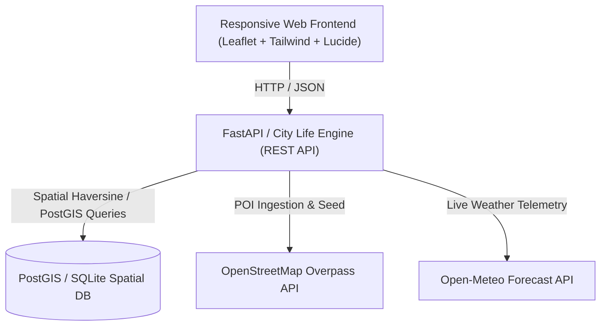

# City Life: Exploring, Experiencing & Navigating the Chaos We Call Home

> *"A city companion that tells you where to go, and how to get there safely, right now."*

**Target City:** San Francisco, CA (Default coordinates: `37.7749, -122.4194`)  
*Configurable to any global city via environment settings.*

---

## 🏛 The Five Pillars

1. **Exploration & Hospitality:** Verified tourist attractions, local food staples, hotels, and budget-friendly places.
2. **History & Culture:** Historical landmarks, heritage sites, cultural tips, architectural eras, and local festivals.
3. **Safety & Security:** Transparent safety scorecards, reported unsafe zones, accident hotspots, and safe routing.
4. **Best vs Worst Places:** Side-by-side radar and table comparisons across 5 core dimensions: Safety, Cleanliness, Affordability, Ratings, and Accessibility.
5. **Smart City Insights:** Live Open-Meteo weather alerts, traffic corridor indicators, verified citizen reports, and news signals.

---

## ⚠️ Data Sources & Honesty Disclosure

- **Real OpenStreetMap POIs:** Ingested via OpenStreetMap Overpass API (tourist attractions, restaurants, hotels, museums, emergency hospitals, and police stations).
- **Real Weather & Alerts:** Real-time atmospheric metrics from the Open-Meteo Forecast API (no API key required).
- **Simulated Safety & Incident Data:** Where official real-time municipal crime or incident streams are private, realistic synthetic incident data and hotspots have been seeded for demonstration purposes. **All synthetic data is explicitly badged and labeled as "Simulated data" throughout the user interface and APIs.**

---

## 🏗 System Architecture



---

## 🚀 Quickstart & Setup

### Prerequisites
- Python 3.10+ (Standard Python runtime is all that is required for the zero-dependency mode)

### 1. Initialize & Seed Database
```powershell
python backend/seed.py
```
*(Optionally append `--live-overpass` to query live OpenStreetMap Overpass servers)*

### 2. Launch Application Server
```powershell
python run_server.py
```
Open **[http://localhost:8000](http://localhost:8000)** in your browser.

### 3. Running with FastAPI & Uvicorn (Production)
```bash
pip install -r backend/requirements.txt
uvicorn backend.app.main:app --host 0.0.0.0 --port 8000 --reload
```
Interactive OpenAPI documentation available at: **[http://localhost:8000/docs](http://localhost:8000/docs)**

### 4. Running with Docker Compose (PostgreSQL + PostGIS)
```bash
docker-compose up --build
```

---

## 🧪 Automated Testing
Run the Step 1 verification test suite:
```powershell
python backend/tests/test_step1.py
```
